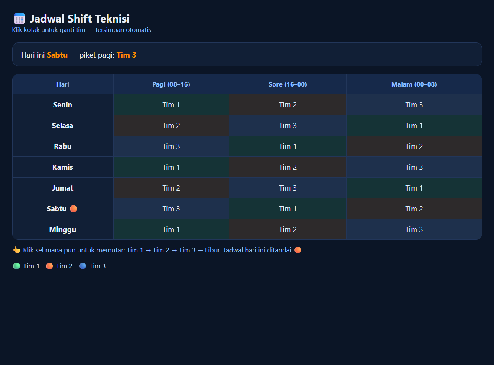

# 📅 Jadwal Shift Teknisi (Node.js murni)

Penjadwal shift mingguan 3 tim + libur. Klik sel untuk memutar tim, tersimpan otomatis ke `db.json`. **Tanpa `npm install`** — hanya modul bawaan Node (`http`, `fs`, `path`).


## Fitur

- Tabel 7 hari × 3 shift (Pagi/Sore/Malam), rotasi otomatis awal
- Klik sel: Tim 1 → Tim 2 → Tim 3 → Libur
- Penanda hari ini 🟠 + info piket pagi
- API JSON: `GET /api/jadwal`, `POST /api/jadwal`

## Jalankan

```bash
node server.js
# buka http://127.0.0.1:3000
```



## API

```bash
curl -X POST localhost:3000/api/jadwal \
  -H 'Content-Type: application/json' \
  -d '{"hari":"Sabtu","shift":"Malam (00–08)","tim":"Tim 2"}'
```

MIT — dulkemot 2026
